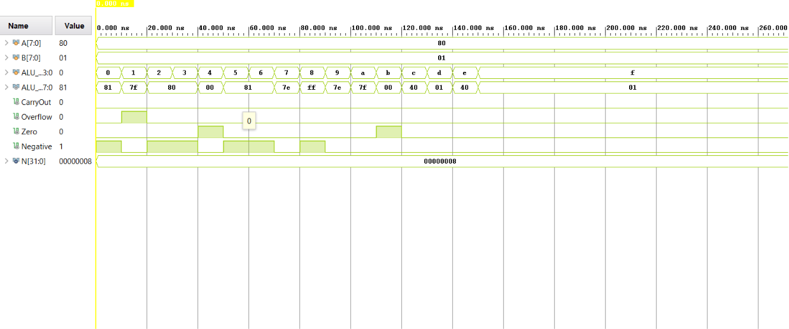

# Parametric Arithmetic Logic Unit (ALU) Implementation

A high-performance hardware description language (HDL) implementation of an Arithmetic Logic Unit (ALU) designed in **Verilog RTL** and fully validated using **Xilinx Vivado**. The architecture is structured for high modularity, scalability, and seamless integration into broader processor microarchitectures (such as RISC-V or custom CPU data paths).

---

## 🛠 Features & Operations

This ALU supports a comprehensive instruction set architecture (ISA) subset, covering arithmetic computations, bitwise logical processing, and hardware condition flag generation.

### Supported Operations

| Opcode (Control) | Operation | Description | Category |
| :--- | :--- | :--- | :--- |
| `4'b0000` | **ADD** | Arithmetic Addition (`A + B`) | Arithmetic |
| `4'b0001` | **SUB** | Arithmetic Subtraction (`A - B`) | Arithmetic |
| `4'b0010` | **AND** | Bitwise Logical AND (`A & B`) | Logical |
| `4'b0011` | **OR** | Bitwise Logical OR (`A \| B`) | Logical |
| `4'b0100` | **XOR** | Bitwise Logical XOR (`A ^ B`) | Logical |
| `4'b0101` | **NOT** | Bitwise Inversion of Input A (`~A`) | Logical |
| `4'b0110` | **SLL** | Shift Left Logical (`A << B`) | Shift |
| `4'b0111` | **SRL** | Shift Right Logical (`A >> B`) | Shift |

### Hardware Status Flags
The ALU dynamically generates critical flags on every clock cycle/evaluation for control unit branching and conditional handling:
* **Zero Flag (Z):** Asserts high (`1'b1`) when the operational result is exactly zero.
* **Carry Out Flag (C):** Asserts high when an arithmetic execution produces an overflow bit past the MSB.
* **Overflow Flag (V):** Detects signed arithmetic truncation bugs (e.g., adding two positive values resulting in a negative number).
* **Sign Flag (S):** Captures the sign bit (MSB) of the computational result for negative status detection.

---

## 📂 Repository Architecture

```text
NbiTALU/
├── NbiTALU.srcs/            # Hardware Source Tree
│   ├── sources_1/new/      # Design RTL Modules (*.v, *.sv)
│   └── sim_1/new/          # Verification Suites / Testbenches
├── NbiTALU.sim/             # Waveform Simulation Snapshot Configurations
├── NbiTALU.xpr             # Primary Xilinx Vivado Project File
└── .gitignore               # Automated EDA Tool Compilation Filters
```

---

## 🚦 Verification & Testbench Setup

The module includes a self-checking testbench framework (`NbiTALU_tb.v`) validating corner cases, boundary conditions, arithmetic overflow tolerances, and exhaustive operational logic.

### How to Run Simulation (Xilinx Vivado)
1. **Initialize Project:** Launch Xilinx Vivado and select **Open Project**, pointing to the `NbiTALU.xpr` file.
2. **Set Top Module:** In the **Sources** pane, expand the `Simulation Sources` hierarchy, right-click your testbench module, and select **Set as Top**.
3. **Run RTL Simulation:** Click **Run Simulation** from the left-side Flow Navigator toolbar, then choose **Run Behavioral Simulation**.
4. **Analyze Waveforms:** Use the `Waveform View` window to inspect signal paths, inputs (`A`, `B`), opcode control configurations, and matching flag triggers.

---
## Simulation output


---

## 💻 Future Enhancements
- [ ] Implement fully pipelined staging to maximize operational frequency ($F_{max}$).
- [ ] Add support for Multiplier-Accumulator (MAC) operations.
- [ ] Optimize structural hardware layouts down to the FPGA Look-Up Table (LUT) level to minimize device area.
